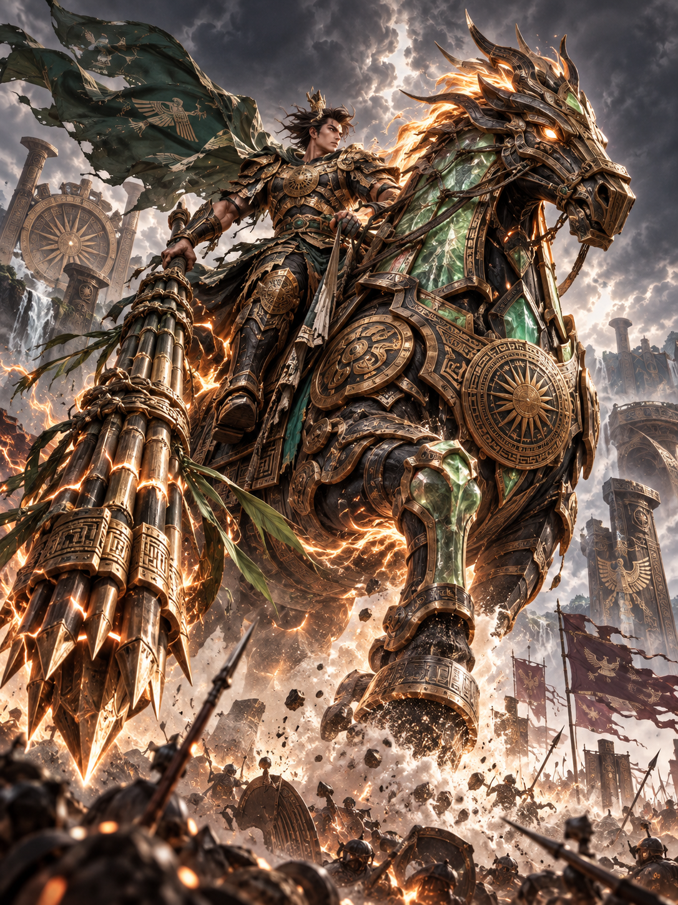
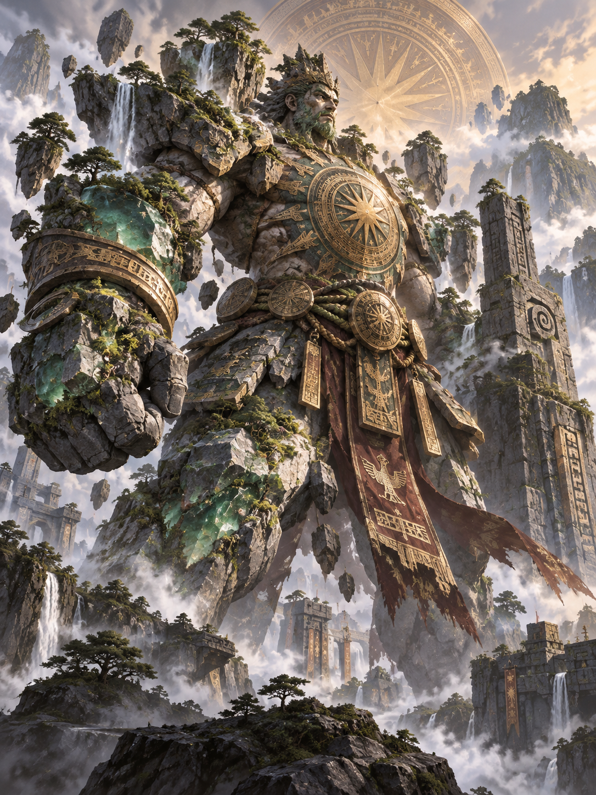
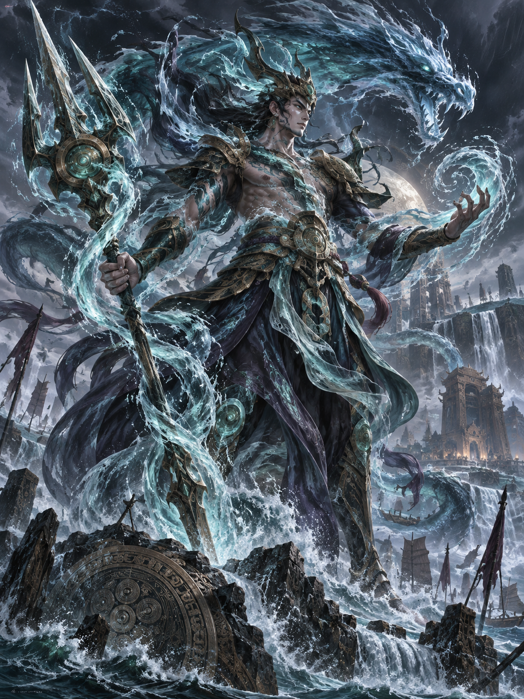
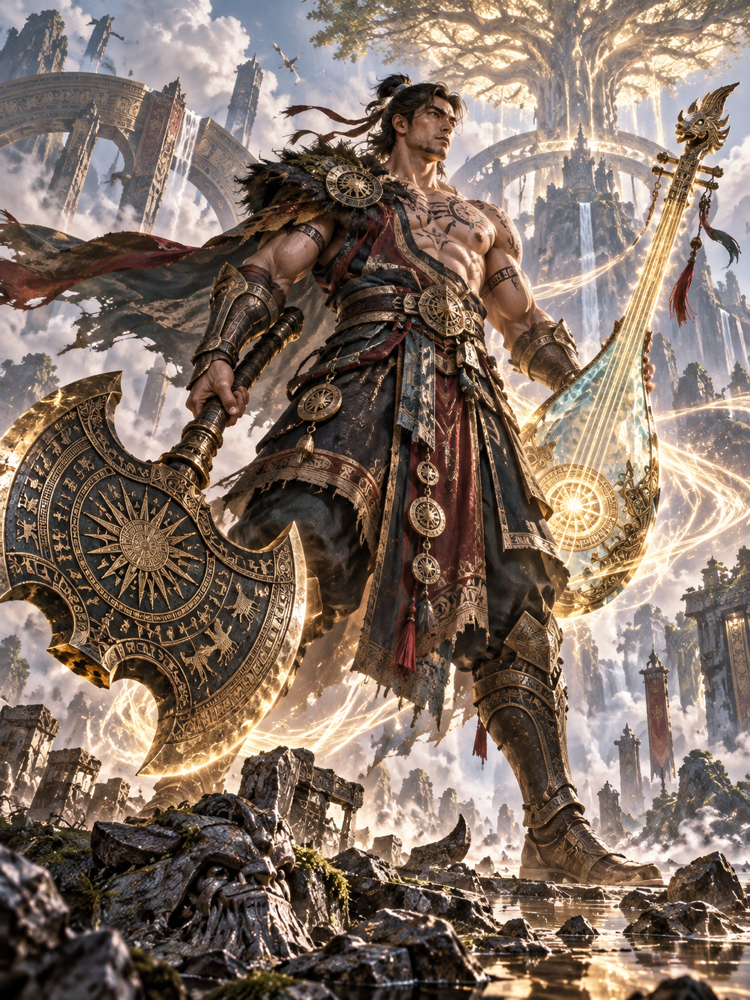
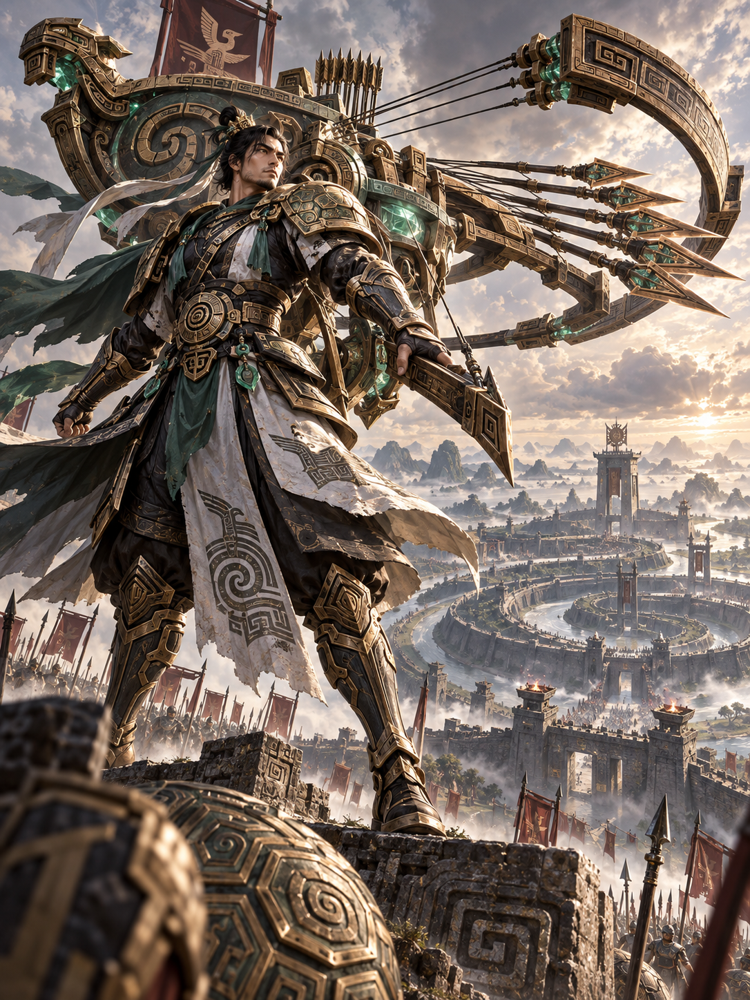

# 103 · Bộ Ngũ Thần Thoại Cổ Linh — Master Concept Bible (Mythic Quintet)

**Trạng thái tài liệu:** `ART_APPROVED / CONCEPT_APPROVED / GAMEPLAY_PENDING`  
**Nhóm phân loại:** Nhóm Tướng Biểu Tượng Thần Thoại (Mythic High-Fantasy Quintet — Research IDs #43 → #47)  
**Tài liệu tham chiếu:** [100 — Rivalry Audit](100-roster-v5-round4-selection-rivalry-audit.md), [102 — Beginner Concept Shortlist](102-roster-v5-beginner-concept-shortlist.md), [91 — Khóa Input QWER-D](91-khoa-input-qwer-d.md).  
**Kho lưu trữ Art Concepts:** `art-concepts/` (5 tác phẩm hình ảnh đã được Owner chính thức phê duyệt).

---

## 1. Tôn Chỉ & Chuẩn Art Direction: Thần Thoại Hóa Cổ Linh

Theo chỉ đạo chiến lược của Owner:
1. **Không phục dựng dã sử mộc mạc hay cổ tích dân gian bình dân:** Bộ Ngũ không phải những nông dân mặc áo nâu hay dũng sĩ cưỡi ngựa thông thường.
2. **Quy mô Thần Thoại Tinh Thạch Cổ Đại (Ancient Cosmic / Titan Fantasy):** Mọi nhân vật đều được thần thoại hóa thành các thực thể tầm cỡ á thần, titan, pháo đài sống hoặc chúa tể nguyên tố ngự trị nền văn minh Cổ Linh triệu năm trước.
3. **Người chơi nhận ra ngay bản sắc cội nguồn:** Dù khoác lên mình hình hài vĩ đại và công nghệ Tinh Thạch cổ đại, người chơi vẫn lập tức nhận ra các biểu tượng văn hóa bất hủ:
   - Chiến tướng kỵ mã cơ khí và bụi tre sấm sét (*Thánh Gióng* $\rightarrow$ **Phù Dong #43**).
   - Colossus dời non lấp bể, ngực rực Thái Dương Đông Sơn (*Sơn Tinh* $\rightarrow$ **Tản Sơn #44**).
   - Rồng đen dâng đại hồng thủy (*Thủy Tinh* $\rightarrow$ **Triều Bá #45**).
   - Thần búa rìu chém nứt đất cùng tiếng đàn giải hòa (*Thạch Sanh* $\rightarrow$ **Dũng Thạch #46**).
   - Nỏ thần mai rùa cắm chốt bắn vạn mũi tên sao băng (*Nỏ Liên Châu Cao Lỗ* $\rightarrow$ **Cổ Lỗ #47**).
4. **Tuyệt đối tuân thủ chuẩn Input 91:** Phím **D** là Dash phổ quát của game; toàn bộ gameplay toys của 5 tướng được phân bổ nghiêm ngặt trong hệ thống đòn đánh và bộ kỹ năng Q/W/E/R.

```
┌────────────────────────────────────────────────────────────────────────────────────────┐
│                   BẢNG TỔNG QUAN BỘ NGŨ THẦN THOẠI CỔ LINH                            │
├────┬───────────┬────────────────────┬──────────────────┬───────────────────────────────┤
│ ID │ DANH XƯNG │ PHÂN LỚP CHIẾN ĐẤU │ CẢM HỨNG CỐT LÕI │ CORE GAMEPLAY TOY ĐỘC BẢN     │
├────┼───────────┼────────────────────┼──────────────────┼───────────────────────────────┤
│#43 │ PHÙ DONG  │ Vanguard / Initiator│ Thánh Gióng      │ Thiết Mã Kỵ Kích & Khoảnh khắc│
│    │           │ (Tiên Phong Lôi Hỏa│                  │ Kiếm Gãy Nhổ Tre Thần Càn Quét│
├────┼───────────┼────────────────────┼──────────────────┼───────────────────────────────┤
│#44 │ TẢN SƠN   │ Juggernaut / Maker │ Sơn Tinh         │ Địa Hình Ngọc Bích Khả Thông  │
│    │           │ (Thành Lũy Cổ Sơn) │                  │ & Thái Dương Đông Sơn Trấn Áp │
├────┼───────────┼────────────────────┼──────────────────┼───────────────────────────────┤
│#45 │ TRIỀU BÁ  │ Deluge Controller  │ Thủy Tinh        │ Tam Long Xoáy Nước Đạn Đạo &  │
│    │           │ (Chúa Tể Thủy Vực) │                  │ Dâng Triều Hút / Đẩy Đội Hình │
├────┼───────────┼────────────────────┼──────────────────┼───────────────────────────────┤
│#46 │ DŨNG THẠCH│ Harmonic Bruiser   │ Thạch Sanh       │ Trảm Kích Rìu Xéo Nứt Đất &   │
│    │           │ (Cuồng Chiến Thánh)│                  │ Thiên Cầm Thánh Âm Giải Hòa   │
├────┼───────────┼────────────────────┼──────────────────┼───────────────────────────────┤
│#47 │ CỔ LỖ     │ Siege Artillery    │ Nỏ Thần Cao Lỗ   │ Cắm Chốt Pháo Đài Mai Rùa &   │
│    │           │ (Pháo Đài Vạn Tiễn)│                  │ Bão Tiễn Liên Châu Xuyên Xạ   │
└────┴───────────┴────────────────────┴──────────────────┴───────────────────────────────┘
```

---

## 2. Chi Tiết Master Concept & Hai Dạng Thể (Mythic Form & Battle Form)

Để giải quyết triệt để bài toán: **Giữ nguyên quy mô thần thoại từ ảnh đã duyệt nhưng hiển thị sắc nét, chuẩn mực ở góc camera MOBA Isometric từ trên xuống (top-down)**, mỗi tướng được định nghĩa tường minh qua hai cấp độ hình thể:
- **MYTHIC FORM (Bản Thể Thần Thoại):** Thẩm mỹ đỉnh cao, quy mô hoành tráng dùng cho Cinematic, Poster, Splash Art 3D và hoạt ảnh xuất hiện (Spawn/Recall).
- **BATTLE FORM (Hình Thể Chiến Đấu Trong Trận):** Mesh mô hình 3D tối ưu cho góc nhìn từ trên xuống trong trận 5v5; footprint va chạm chuẩn, độ cao vừa vặn, silhouette phân khối rõ nét, không gây cản trở camera hay che khuất sàn đấu.

---

### 2.1. PHÙ DONG (#43 — THIẾT MÃ THIÊN TƯỚNG)
*Tiên phong càn quét cơ khí thần thoại — Chiến tướng cưỡi thiết mã lôi hỏa.*

  
*Tác phẩm thẩm định mỹ thuật: [`art-concepts/01-phu-dong-thiet-ma.png`](art-concepts/01-phu-dong-thiet-ma.png)*

#### A. Player Fantasy
> **"Tôi pick Phù Dong vì tôi muốn hóa thân thành một chiến thần cưỡi ngựa sắt khổng lồ càn lướt qua mọi phòng tuyến; và khi thần kiếm gãy vụn, tôi nhổ bật cả cụm tre sấm sét thần thánh để quét sạch toàn bộ chiến trường!"**

#### B. Định Nghĩa Hình Thể: Mythic Form vs. Battle Form
- **MYTHIC FORM (Bản Thể Thần Thoại):**
  - **Cấu trúc hình thể:** Chiến tướng kỵ mã khổng lồ (Mounted War Entity). Chủ tướng giáp trụ lôi đình uy nghi ngồi trên lưng **Thiết Mã Cổ Linh** đúc bằng đồng đen, mắt rực lửa và khớp nối phát quang năng lượng Tinh Thạch đỏ cam. Không phải nhân mã lai ghép cơ thể (không phải Centaur); người và ngựa là hai cá thể sinh học - cơ khí riêng biệt nhưng gắn kết chặt chẽ qua hệ thống yên cương và năng lượng cộng hưởng.
  - Chiều cao tổng thể quy mô thần thoại: $\approx 4.2\text{m}$. Vó ngựa dập ra lốc xoáy lôi hỏa xé toạc mặt đất.
- **BATTLE FORM (Hình Thể Trong Trận 5v5):**
  - **Tỷ lệ & Kích thước camera MOBA:** Chiều cao mô hình trong trận co về $\approx 2.4\text{m}$ (tương đương kích thước kỵ sĩ lớn như Hecarim/Chaos Knight nhưng thân hình bề thế, đầm chắc). Bán kính va chạm sàn đấu (Collision Radius) đạt chuẩn $0.75\text{m}$ (không cồng kềnh quá mức).
  - **Silhouette nhận diện từ trên xuống (Top-down):**
    - Điểm nhấn thị giác chính là bờm lửa đồng đỏ rực của Thiết Mã và dải lụa chiến bào sau lưng Chủ Tướng bay phần phật theo hướng di chuyển.
    - Thanh **Cổ Thần Kiếm** dài cầm ở tay phải có vệt sáng vàng kim rõ nét, tạo quỹ đạo đâm chém sắc bén.
  - **Quy tắc điều khiển thống nhất:** Một thực thể điều khiển duy nhất (1 controller, 1 thanh máu, 1 hitbox chung, không có cơ chế xuống ngựa).

#### C. Core Gameplay Toy — Thiết Mã Kỵ Kích & Khoảnh Khắc Kiếm Gãy Nhổ Cổ Trúc
1. **Thiết Mã Xung Lượng (Mounted Momentum):**
   - Phù Dong duy trì chuyển động kỵ mã liên tục. Khi chạy theo đường thẳng, Thiết Mã tích tụ Xung Lượng, gia tăng tốc độ di chuyển và cường hóa đòn đánh tiếp theo thành cú đạp móng sắt lôi hỏa làm choáng nhẹ mục tiêu đầu tiên `[HYPOTHESIS]`.
2. **Khoảnh khắc Huyền Thoại: Kiếm Gãy $\rightarrow$ Nhổ Cổ Trúc (Divine Bamboo Transformation):**
   - **Nguyên tắc kích hoạt thống nhất để nghiên cứu:** Phù Dong sở hữu thanh đo **Lôi Năng Cổ Linh (Thunder Charge)** tích lũy qua giao tranh (gây và nhận sát thương). Khi thanh đo đạt cực hạn hoặc khi kích hoạt Kỹ Năng Tối Thượng (R):
     - Thanh Cổ Thần Kiếm quá tải năng lượng, **vỡ vụn thành các mảnh tinh thạch** rực sáng `[HYPOTHESIS]`.
     - Phù Dong cắm tay xuống mặt đất và **nhổ bật cụm Thiên Lôi Cổ Trúc** (tre Tinh Thạch sấm sét) từ lòng đất trong thời gian chuyển dạng ngắn `[HYPOTHESIS: ~0.5s]`.
   - **Chuyển hóa lối chơi trong trạng thái Cổ Trúc:**
     - Tầm đánh tay chuyển từ cự ly gần ($175$ unit) sang tầm quét hình quạt cực rộng ($325$ unit).
     - Mỗi nhát quất tre phát ra sóng xung kích lôi đình bẻ gãy lá chắn và làm gián đoạn kẻ địch.
     - Đòn quét kết thúc có thể giáng thẳng xuống đất tạo rãnh sấm sét kéo dài làm chậm và hất tung mục tiêu.
     - Sau khi hết thời gian hiệu lực, Phù Dong cắm tre xuống đất tích tụ lại Thần Kiếm mới.

#### D. Counterplay & Điểm Cân Bằng Minh Bạch
- **Quay đầu có quán tính:** Ở tốc độ cao, Thiết Mã có góc bẻ lái rộng hơn bình thường; đối thủ cơ động có thể luồn lách qua các góc địa hình hẹp để né tránh cú húc.
- **Dấu hiệu cảnh báo kiếm gãy rõ ràng:** Trước khi kiếm gãy nhổ tre, toàn thân Phù Dong phát ra tiếng sấm rền và ánh chớp cảnh báo trong $0.5\text{s}$, tạo cửa sổ thời gian để đối phương dùng nút Dash (D) rút lui hoặc chuẩn bị chiêu khống chế ngắt nhịp.

---

### 2.2. TẢN SƠN (#44 — THÁNH SƠN CỔ THẠCH)
*Đỡ đòn cự thạch kiến tạo địa hình — Colossus ngực rực Thái Dương Đông Sơn.*

  
*Tác phẩm thẩm định mỹ thuật: [`art-concepts/04-tan-son-co-thach.png`](art-concepts/04-tan-son-co-thach.png)*

#### A. Player Fantasy
> **"Tôi pick Tản Sơn vì tôi muốn trở thành ngọn núi bất hoại của đồng đội: nâng vách núi ngọc bích từ lòng đất để bảo vệ đồng minh và dùng ngực rực Thái Dương Đông Sơn trấn áp hoàn toàn mọi đợt tập kích của đối phương."**

#### B. Định Nghĩa Hình Thể: Mythic Form vs. Battle Form
- **MYTHIC FORM (Bản Thể Thần Thoại):**
  - Colossus khổng lồ bán thân núi đá sống. Toàn thân kết tinh từ granite xám ngàn năm đan xen các khối ngọc bích xanh thẫm mọc ngược như rặng núi Himalaya.
  - Lồng ngực ngự trị một mặt **Trống Đồng Thái Dương** vàng rực phát ra hào quang mặt trời nguyên thủy. Chiều cao thần thoại $\approx 5.5\text{m}$.
- **BATTLE FORM (Hình Thể Trong Trận 5v5):**
  - **Tỷ lệ & Kích thước camera MOBA:** Chiều cao mô hình co chuẩn về $\approx 2.5\text{m}$ (tương đương Malphite / Tiny cấp 2). Bán kính va chạm $0.8\text{m}$ vững chãi.
  - **Silhouette nhận diện từ trên xuống (Top-down):**
    - Hai vai là hai khối ngọc bích nổi gồ ghề vát góc nghiêng, tạo hình tam giác ngược vững như bàn thạch.
    - Trống Đồng Thái Dương trên ngực phát quang ánh sáng vàng dịu mắt ở mặt trước, giúp người chơi dễ dàng nhận biết hướng quay mặt (facing direction) của Tản Sơn trong giao tranh hỗn loạn.

#### C. Core Gameplay Toy — Vách Núi Ngọc Bích Khả Thông & Thái Dương Trấn Áp
1. **Dựng Lũy Ngọc Bích Khả Thông (Passable Jade Ridge — Đã Audit An Toàn):**
   - Tản Sơn đấm xuống đất, dựng lên một **Vách Núi Ngọc Bích** theo đường thẳng chỉ định `[HYPOTHESIS: tồn tại ~3.0s]`.
   - **Quy tắc an toàn chống phá hoại đồng đội (Anti-Griefing Rule):**
     - Vách núi **ngăn hoàn toàn bước di chuyển và đạn đạo của tướng địch**.
     - **Đồng minh được phép đi xuyên qua vách núi** (chuyển dạng thành lối đi năng lượng mờ đối với phe ta), đồng thời nhận thêm lượng nhỏ giáp khi đi qua.
     - Tản Sơn có thể bấm tái kích hoạt kỹ năng để **chủ động đập vỡ vách đá ngay lập tức**, bắn ra các mảnh ngọc bích làm chậm kẻ địch xung quanh.
     - *Kết quả:* Loại bỏ $100\%$ rủi ro nhốt chết hoặc cản trở đồng đội!
2. **Quang Phổ Thái Dương Đông Sơn (Solar Aegis of Dong Son):**
   - Đĩa trống đồng trên ngực kích hoạt phát luồng sáng hình nón phía trước.
   - Kẻ địch đối diện bị giảm tốc độ đánh và giảm nhẹ tầm nhìn trong thời gian ngắn `[HYPOTHESIS]`.
   - Đồng minh trong vùng sáng được hồi phục một lượng lá chắn đá.

#### D. Counterplay & Điểm Cân Bằng Minh Bạch
- **Độ cơ động thấp:** Tản Sơn di chuyển đầm và chậm chạp, không có kỹ năng lướt riêng (chỉ dùng Dash phím D chung); dễ bị các xạ thủ tầm xa thả diều bào máu ngoài tầm chiêu.
- **Vách núi có thể bị vượt qua bằng kỹ năng:** Các tướng có kỹ năng lướt vượt địa hình hoặc dùng Dash (D) qua khe hẹp hoàn toàn có thể thoát khỏi sự chia cắt của Tản Sơn.

---

### 2.3. TRIỀU BÁ (#45 — HẮC LONG THỦY TỘC)
*Pháp sư kiểm soát thủy vực — Chúa tể biển sâu điều khiển tam long xoáy nước.*

  
*Tác phẩm thẩm định mỹ thuật: [`art-concepts/03-trieu-ba-thuy-long.png`](art-concepts/03-trieu-ba-thuy-long.png)*

#### A. Player Fantasy
> **"Tôi pick Triều Bá vì tôi muốn điều khiển dòng chảy chiến trường: phóng thích ba con rồng nước đen cuộn trào, dâng sóng đại hồng thủy nhấn chìm địa hình và cuốn phăng đội hình địch theo ý muốn!"**

#### B. Định Nghĩa Hình Thể: Mythic Form vs. Battle Form
- **MYTHIC FORM (Bản Thể Thần Thoại):**
  - Chúa tể thủy tộc nửa người nửa rồng uy nghiêm, ngự trên cột nước xoáy ngầm cuộn trào. Mình phủ vảy rồng đen tím thẫm, đầu đội mũ miện san hô hóa thạch.
  - Ba thực thể **Thủy Long Nước Đen** khổng lồ lượn quanh như những cơn bão biển thu nhỏ.
- **BATTLE FORM (Hình Thể Trong Trận 5v5):**
  - **Tỷ lệ & Kích thước camera MOBA:** Mô hình bay là là cách mặt đất $\approx 0.3\text{m}$ trên một gợn xoáy nước mỏng trong suốt (không dùng cột nước cao để tránh che khuất đồng đội). Chiều cao mô hình $\approx 2.1\text{m}$, footprint va chạm $0.6\text{m}$.
  - **Silhouette nhận diện từ trên xuống (Top-down):**
    - Áo choàng vảy rồng đen tím xòe rộng hình quạt khi lơ lửng.
    - Cầm Thủy Thần Kích ba chĩa sáng ánh lân tinh xanh biển ở tay phải.
  - **Audit Ba Thủy Long:** Ba con rồng nước được hiển thị dưới dạng **3 Quả Cầu Năng Lượng Thủy Long (Orbital VFX Serpents)** bay lượn sát quanh người Triều Bá. Tuyệt đối **không phải pet độc lập, không có AI riêng, không có thanh máu riêng**.

#### C. Core Gameplay Toy — Tam Long Đạn Đạo & Đại Hồng Thủy Dâng Sóng
1. **Tam Long Xoáy Nước (Orbital Water Serpents — Đạn Đạo Tích Trữ):**
   - Ba con rồng nước là nguồn đạn đạo trực quan xoay quanh thân mình:
     - **Phóng Rồng:** Triều Bá phóng từng con rồng theo đường thẳng, gây sát thương và để lại vũng nước ngập làm chậm nhẹ kẻ địch `[HYPOTHESIS]`.
     - **Thu Hồi / Giật Dòng:** Khi tái kích hoạt, dòng nước xoáy thu hồi rồng về thân mình, kéo nhẹ kẻ địch đứng trên vệt nước về phía Triều Bá một khoảng ngắn.
     - Khi cả 3 con rồng đã phóng đi, Triều Bá mất hào quang bảo vệ tạm thời cho đến khi rồng hồi lại.
2. **Đại Hồng Thủy (Tidal Deluge Wave):**
   - Triều Bá cắm Thủy Thần Kích xuống đất, dâng lên một đợt sóng thần nước đen quét dọc theo làn đường.
   - Sóng đẩy lùi kẻ địch về hướng dòng chảy và làm gián đoạn các kỹ năng niệm chú kéo dài của đối thủ `[HYPOTHESIS]`.

#### D. Counterplay & Điểm Cân Bằng Minh Bạch
- **Cửa sổ mỏng manh khi hết rồng:** Khi Triều Bá đã tung hết 3 con rồng nước ra xa, lớp giáp nước tự thân suy giảm; đây là thời điểm vàng để sát thủ áp sát trừng phạt.
- **Sóng thần có đường báo trước:** Đợt sóng dâng có âm thanh gầm rú và vệt nước báo trước $0.7\text{s}$, cho phép đối thủ dùng phím Dash (D) né sang hai bên cánh của làn đường.

---

### 2.4. DŨNG THẠCH (#46 — THẦN RÌU & THIÊN CẦM)
*Đấu sĩ cuồng chiến hài hòa — Sức mạnh chém nứt đất song hành cùng thánh âm giải hòa.*

  
*Tác phẩm thẩm định mỹ thuật: [`art-concepts/02-dung-thach-than-riu.png`](art-concepts/02-dung-thach-than-riu.png)*

#### A. Player Fantasy
> **"Tôi pick Dũng Thạch vì tôi muốn trải nghiệm sự kết hợp độc đáo: một chiến thần đồng đen vung đại rìu xé toạc chiến trường khi cận chiến, nhưng lại sở hữu tiếng đàn Thiên Cầm thần thánh có thể hóa giải hiệu ứng bất lợi và làm lắng dịu sự hung hãn của đối thủ!"**

#### B. Định Nghĩa Hình Thể: Mythic Form vs. Battle Form
- **MYTHIC FORM (Bản Thể Thần Thoại):**
  - Chiến thần hộ pháp lực lưỡng, da màu đồng đen cổ sẫm, mình trần khoác giáp dã thú xám bạc.
  - Tay vung cây Đại Rìu Cổ Linh khổng lồ chém nứt trời đất; lưng đeo chiếc **Thiên Cầm Tinh Thạch 7 dây** bằng gỗ lim cổ và tơ ngọc bích phát sáng huyền ảo.
- **BATTLE FORM (Hình Thể Trong Trận 5v5):**
  - **Tỷ lệ & Kích thước camera MOBA:** Chiều cao mô hình $\approx 2.2\text{m}$, vóc dáng biped cơ bắp vạm vỡ, footprint va chạm $0.65\text{m}$.
  - **Silhouette nhận diện từ trên xuống (Top-down):**
    - Lưỡi đại rìu sáng ánh bạc sắc lẹm vác chéo trước ngực, chiếm trọn sự chú ý trong các pha áp sát.
    - Chiếc Thiên Cầm được thu gọn ép sát sau lưng, chỉ phát sáng viền ngọc bích khi kỹ năng đàn sẵn sàng hồi chiêu, giúp đối thủ dễ dàng nhận biết Dũng Thạch có còn chiêu giải cứu hay không.

#### C. Core Gameplay Toy — Cuồng Trảm Nứt Đất & Khúc Ca Thiên Cầm (Đã Audit Quyền Lực)
1. **Trảm Kích Xé Đất (Fissure Cleave — Thế Rìu):**
   - Đòn đánh tay và kỹ năng rìu của Dũng Thạch mang sát thương vật lý nặng. Đòn đánh thứ 3 giáng thẳng rìu xuống đất tạo rãnh nứt địa chấn ngắn, gây sát thương chuẩn lên kẻ địch có giáp cao `[HYPOTHESIS]`.
2. **Thánh Âm Thiên Cầm (Harmonic Strings Resonance — Thế Đàn — Đã Tinh Giản Quyền Lực):**
   - **Audit điều kiện kích hoạt ngặt nghèo:**
     - Dũng Thạch **KHÔNG THỂ gảy đàn nếu bản thân đang bị Choáng Nặng (Stun), Áp Chế (Suppression) hoặc Hất Tung (Airborne)**. Tiếng đàn không phải là nút bất tử hay tự giải mọi thứ vô điều kiện.
     - Khi tự do hoặc chỉ bị khống chế mềm (Làm chậm, Trói chân), Dũng Thạch có thể gảy Thiên Cầm:
       - **Giải phóng khống chế mềm** (Làm chậm, Giảm tốc đánh, Trói chân) cho bản thân và đồng minh đứng sát cạnh trong bán kính nhỏ `[HYPOTHESIS]`.
       - Phát ra sóng âm làm dịu, **giảm $25\%$ sát thương gây ra của kẻ địch xung quanh trong $1.5\text{s}$** `[HYPOTHESIS]`.
     - **Cái giá phải trả (Trade-off):** Trong $1.0\text{s}$ gảy đàn, Dũng Thạch bị khựng lại và không thể vung rìu tấn công, đòi hỏi tính toán thời điểm chính xác giữa việc gây sát thương hay bảo vệ đội hình.

#### D. Counterplay & Điểm Cân Bằng Minh Bạch
- **Phụ thuộc tầm cận chiến:** Khi ở thế vung rìu, Dũng Thạch không có chiêu lướt xa hay kéo mục tiêu; dễ bị các tướng đánh xa cấu rỉa thả diều.
- **Dễ bị ngắt nhịp bằng Hard CC:** Nếu đối phương dồn khống chế cứng (choáng/áp chế) vào thẳng Dũng Thạch trước, Dũng Thạch hoàn toàn không thể bấm gảy đàn để tự cứu mình.

---

### 2.5. CỔ LỖ (#47 — HUYỀN QUY THẦN CƠ SƯ)
*Xạ thủ pháo đài công thành — Bậc thầy nỏ thần mai rùa bắn vạn tiễn xuyên lục địa.*

  
*Tác phẩm thẩm định mỹ thuật: [`art-concepts/05-co-lo-than-no.png`](art-concepts/05-co-lo-than-no.png)*

#### A. Player Fantasy
> **"Tôi pick Cổ Lỗ vì tôi muốn làm một pháo đài công thành vững chãi: cắm rễ mai rùa khổng lồ xuống mặt đất, kích hoạt cỗ nỏ Liên Châu thần cơ và xả hàng vạn mũi tên tinh thạch sáng rực bầu trời như mưa sao băng xuyên thủng phòng tuyến địch!"**

#### B. Định Nghĩa Hình Thể: Mythic Form vs. Battle Form
- **MYTHIC FORM (Bản Thể Thần Thoại):**
  - Thần Cơ Sư mang phong thái bậc thầy công thành, cõng trên lưng chiếc **Mai Rùa Đồng Khổng Lồ (Huyền Quy Fortress Shell)** viền móng rùa vàng sắc bén.
  - Cánh tay phải tích hợp cỗ nỏ cơ khí Liên Châu đa nòng với hệ thống bánh răng Tinh Thạch tự động nạp vạn mũi tên năng lượng.
- **BATTLE FORM (Hình Thể Trong Trận 5v5):**
  - **Tỷ lệ & Kích thước camera MOBA:** Chiều cao mô hình $\approx 2.0\text{m}$, footprint va chạm $0.65\text{m}$.
  - **Silhouette nhận diện từ trên xuống (Top-down):**
    - Chiếc mai rùa đồng tạo thành một khối vòm bán cầu rõ rệt bảo vệ phía sau lưng.
    - Ống nỏ cơ khí vươn dài về phía trước, có đèn báo số lượng tên năng lượng sẵn sàng khai hỏa.
    - Khi chuyển sang trạng thái Cắm Chốt (Siege Stance), bốn chân cơ khí của mai rùa cắm phập xuống đất với vòng sáng Tinh Thạch neo sàn rõ nét, giúp mọi người chơi trên bản đồ nhận biết ngay trạng thái pháo đài.

#### C. Core Gameplay Toy — Chuyển Dạng Pháo Đài Mai Rùa (Đã Audit Điểm Yếu)
1. **Trạng Thái Cơ Động (Mobile Stance):**
   - Tầm bắn tiêu chuẩn ($550$ unit), bắn từng mũi tên đồng xuyên thấu, tốc độ chạy bình thường.
2. **Trạng Thái Cắm Chốt (Siege Fortress Stance — Đã Khóa Điểm Yếu Thực Sự):**
   - Mai rùa cắm chân xuống đất sau độ trễ $0.6\text{s}$:
     - Tốc độ chạy giảm về $0$ (tự bất động tại chỗ).
     - Tầm bắn gia tăng lên cự ly pháo binh ($850$ unit) `[HYPOTHESIS]`.
     - Nhận thêm giáp chống chịu từ hướng lưng mai rùa.
   - **Ba điểm yếu sống còn (Essential Vulnerabilities — Đã Audit):**
     1. **VÙNG MÙ CẬN CHIẾN (Minimum Range Blindspot):** Nỏ thần tầm xa có góc nâng nòng cố định; kẻ địch áp sát trong phạm vi $250$ unit quanh người sẽ **hoàn toàn không bị nỏ bắn trúng**!
     2. **TỐC ĐỘ XOAY NÒNG HẠN CHẾ (Slow Pivot Rate):** Cổ Lỗ xoay góc bắn chậm chạp khi đổi mục tiêu lệch quá 90 độ, tạo cơ hội cho sát thủ bọc sườn.
     3. **ÁP TRẦN SÁT THƯƠNG CÔNG TRÌNH:** Mũi tên bắn vào trụ và nhà lính bị giảm $50\%$ sát thương, chỉ mang tính ép góc phòng thủ chứ không thể phá hủy trụ tức thời.
3. **Bão Tiễn Liên Châu (Volley of Thousand Bolts):**
   - Khi ở trạng thái Cắm Chốt, Cổ Lỗ có thể phóng loạt tiễn vút lên trời rồi dội xuống một khu vực chỉ định từ khoảng cách xa, gây sát thương diện rộng và làm chậm nhẹ kẻ địch `[HYPOTHESIS]`.

#### D. Counterplay & Điểm Cân Bằng Minh Bạch
- **Tử huyệt bất động & Vùng mù cận chiến:** Khi Cổ Lỗ đã cắm chốt, việc lao thẳng vào người hoặc đi vòng ra sau lưng sẽ khiến Cổ Lỗ hoàn toàn tê liệt hỏa lực cận chiến.
- **Thời gian thu nỏ tạo cửa sổ trừng phạt:** Muốn nhổ chân rút chạy cần $0.5\text{s}$, đối phương có đủ thời gian để dồn sát thương dứt điểm nếu Cổ Lỗ cắm chốt sai vị trí.

---

## 3. So Sánh Bản Sắc & Triết Lý Chống Đạo Nhái (IP Safeguards)

Hội đồng rà soát nghiêm ngặt để đảm bảo Bộ Ngũ Thần Thoại Cổ Linh độc bản, tách bạch khỏi các nhân vật MOBA kinh điển:

```
┌───────────┬─────────────────────────┬────────────────────────────────────────────────────────┐
│ TƯỚNG     │ NGUY CƠ NHẬM LẪN        │ BẢN SẮC CỔ LINH ĐỘC BẢN & RÀO CHẮN BẢN QUYỀN           │
├───────────┼─────────────────────────┼────────────────────────────────────────────────────────┤
│ PHÙ DONG  │ Hecarim (LoL) /         │ • Hecarim là nhân mã ma quái cầm lưỡi hái u linh.      │
│           │ Chaos Knight (Dota)     │ • Phù Dong là CHIẾN TƯỚNG CƯỠI THIẾT MÃ LÔI HỎA.       │
│           │                         │ • Gameplay Toy: Cơ chế Thần Kiếm Gãy chuyển sang       │
│           │                         │   nhổ cụm Cổ Trúc Tinh Thạch càn quét diện rộng.       │
├───────────┼─────────────────────────┼────────────────────────────────────────────────────────┤
│ TẢN SƠN   │ Malphite (LoL) /        │ • Malphite là tảng đá lăn đâm húc stat-check.          │
│           │ Tiny / Earthshaker(Dota)│ • Tản Sơn là Kiến Trúc Sư Địa Hình ngọc bích có lối    │
│           │                         │   đi an toàn cho đồng đội + ngực Trống Đồng Đông Sơn   │
│           │                         │   chiếu hào quang bảo hộ và trấn áp đối thủ.           │
├───────────┼─────────────────────────┼────────────────────────────────────────────────────────┤
│ TRIỀU BÁ  │ Nami (LoL) /            │ • Nami là người cá hỗ trợ bong bóng nước vui tươi.     │
│           │ Tidehunter / Kunkka     │ • Triều Bá là BẠO CHÚA BIỂN SÂU HẮC LONG, điều khiển   │
│           │                         │   3 rồng nước đạn đạo (không pet) vừa kéo vừa đẩy và   │
│           │                         │   dâng đại hồng thủy nuốt trọn làn đường.              │
├───────────┼─────────────────────────┼────────────────────────────────────────────────────────┤
│ DŨNG THẠCH│ Olaf (LoL) /            │ • Olaf là berserker cuồng loạn lao vào chém vô thức.   │
│           │ Axe (Dota)              │ • Dũng Thạch kết hợp ĐỐI NGHỊCH BIỂU TƯỢNG: Thần Rìu   │
│           │                         │   bổ nứt đất nhưng ngự Thiên Cầm gảy thánh âm giải     │
│           │                         │   khống chế và làm dịu chiến trận (có trade-off).      │
├───────────┼─────────────────────────┼────────────────────────────────────────────────────────┤
│ CỔ LỖ     │ Xerath (LoL) /          │ • Xerath/Sniper chỉ là đứng xa bắn tỉa đơn thuần.      │
│           │ Sniper (Dota)           │ • Cổ Lỗ là PHÁO ĐÀI HUYỀN QUY MAI RÙA cắm chốt, có     │
│           │                         │   vùng mù cận chiến rõ rệt và bắn bão tiễn liên châu.  │
└───────────┴─────────────────────────┴────────────────────────────────────────────────────────┘
```

---

## 4. Đề Xuất Đội Hình Biểu Tượng (Iconic Thematic Composition)

> **Lưu ý nguyên tắc thiết kế:** Đây là **đề xuất đội hình phối hợp biểu tượng (Thematic Showcase)** để minh họa tính gắn kết giữa các hệ thống kỹ năng trong giao tranh 5v5. **Tuyệt đối không phải điều kiện ràng buộc**: Mỗi nhân vật trong Bộ Ngũ đều sở hữu bộ kỹ năng và giá trị chiến thuật độc lập, vận hành hoàn hảo trong mọi đội hình MOBA thông thường.

```
                  ┌────────────────────────────────────────────────────────┐
                  │       ĐỀ XUẤT ĐỘI HÌNH BỘ NGŨ THẦN THOẠI CỔ LINH       │
                  ├───────────────────┬────────────────────────────────────┤
                  │ ĐƯỜNG TRÊN (TOP)  │ TẢN SƠN (#44 — Tank / Terrain Maker│
                  │ ĐI RỪNG (JUNGLE)  │ PHÙ DONG (#43 — Initiator/Vanguard)│
                  │ ĐƯỜNG GIỮA (MID)  │ TRIỀU BÁ (#45 — Deluge Controller) │
                  │ XẠ THỦ (BOT CARRY)│ CỔ LỖ (#47 — Artillery Marksman)   │
                  │ HỖ TRỢ (SUPPORT)  │ DŨNG THẠCH (#46 — Harmonic Bruiser)│
                  └───────────────────┴────────────────────────────────────┘
                                            │
                             [KỊCH BẢN PHỐI HỢP CHIẾN THUẬT]
                                            │
  1. Tản Sơn dựng vách đá chặn đường rút của địch và chiếu hào quang Thái Dương
  2. Phù Dong thúc Thiết Mã mở giao tranh, kích hoạt nhổ Cổ Trúc càn quét tuyến trước
  3. Triều Bá dâng Đại Hồng Thủy cuốn trôi các mục tiêu bị chia cắt vào góc hẹp
  4. Cổ Lỗ cắm chốt Mai Rùa xả bão tiễn liên châu tầm xa kết liễu đội hình địch
  5. Dũng Thạch bảo vệ tuyến sau, vung rìu cản sát thủ và gảy đàn giải nguy cho Cổ Lỗ!
```

---

## 5. Kết Luận & Bàn Giao Kế Hoạch Sản Xuất

1. **Khóa Chuẩn Visual:** Bộ 5 hình ảnh tại `art-concepts/` giữ nguyên giá trị chuẩn mực hình ảnh.
2. **Chuyển Tiếp Chiến Lược:** Toàn bộ dữ liệu thiết kế của Bộ Ngũ Thần Thoại `#43 → #47` được chuyển giao trực tiếp sang **[104 · Full Approved Roster Production Master Plan](104-full-approved-roster-production-master-plan.md)** để bước vào dây chuyền sản xuất 3D, Rigging, VFX và Tích hợp Runtime thực tế.
3. **Kỷ luật kỹ thuật:** Không tuyên bố PASS_ENGINE trên tài liệu khi chưa chạy trên engine thực tế. Mọi số liệu thời gian và cự ly trong tài liệu này mang tính giả định thiết kế và được đánh dấu nghiêm ngặt là `[HYPOTHESIS]`.
